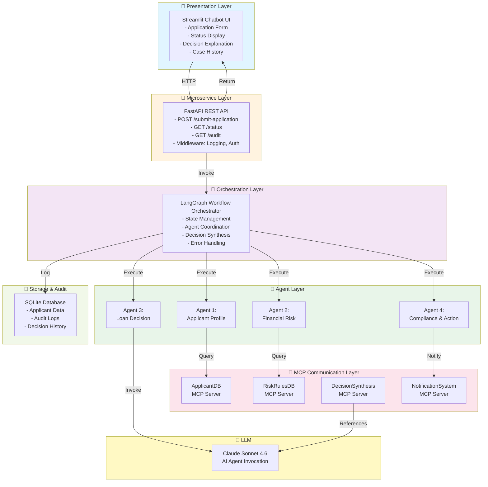

# System Design Document: Agentic AI Intelligent Loan Approval System

## 1. Architecture Overview

### Layered Architecture Diagram



### Data Flow Description

**High-Level Flow:**
1. **User Submission** → Streamlit UI collects loan application data
2. **API Validation** → FastAPI validates input fields per spec (requirements.md)
3. **Orchestration Init** → LangGraph receives validated data; creates trace ID and state object
4. **Agent Execution** → LangGraph sequentially invokes agents (Profile → Financial → Decision → Compliance)
5. **Agent Analysis** → Each agent queries its MCP server and calls Claude AI for analysis
6. **Decision Synthesis** → Loan Decision Agent aggregates all findings and applies decision rules
7. **Audit & Action** → Compliance Agent logs decision and triggers notifications
8. **Response Return** → Final decision returned to UI with explanation
9. **Persistence** → Decision and audit trail persisted to SQLite

### Communication Patterns

| Communication | Type | Protocol | Latency Target |
|---|---|---|---|
| **Streamlit → FastAPI** | Synchronous HTTP | REST JSON | < 100 ms |
| **FastAPI → LangGraph** | In-process (Python) | Function call | < 50 ms |
| **LangGraph → Agents** | In-process (Python) | Function call | < 1 ms |
| **Agents → MCP Servers** | Synchronous RPC | FastMCP | < 500 ms |
| **Agents → Claude AI** | Async with timeout | Anthropic SDK | < 2 seconds (p95) |
| **LangGraph → SQLite** | Async write-behind | SQL | < 100 ms |

---

## 2. Component Design Per Layer

### Layer 1: Presentation Layer (Streamlit)

**Responsibilities:**
- Render loan application form with 10 input fields
- Collect user data with client-side validation
- Display application status (Submitted → Processing → Complete)
- Show final decision with explanation
- Provide case lookup and audit trail view

**Key Components:**

| Component | Purpose | Implementation |
|---|---|---|
| `Application Form` | Collect applicant data | Streamlit form widgets (text_input, number_input, selectbox) |
| `Session State Manager` | Persist state across reruns | `st.session_state` dictionary |
| `Status Display` | Show real-time processing status | `st.spinner()`, `st.status()` |
| `Decision Card` | Display final decision with explanation | Custom styled container with color coding |
| `Audit Trail UI` | Show decision history | Dataframe with filters by date/applicant_id |

**Ports/APIs:**
- **Input:** User-submitted loan application data (10 fields)
- **Output:** HTTP POST request to FastAPI `/api/v1/applications`
- **Response Handler:** Display decision JSON response, map to UI components

**Sample UI Flow:**
```
┌─────────────────────────────────┐
│  Loan Application Chatbot       │
├─────────────────────────────────┤
│  Applicant ID:     [________]   │
│  Age:              [__]         │
│  Income:           [_______]    │
│  Employment Type:  [Dropdown]   │
│  Credit Score:     [___]        │
│  Loan Amount:      [_______]    │
│  Tenure (Months):  [___]        │
│  Liabilities:      [_______]    │
│  Location:         [__]         │
│  Timestamp:        [auto-filled]│
│                                 │
│         [ Submit Application ]  │
└─────────────────────────────────┘
         ↓
  [Processing...] (spinner)
         ↓
┌─────────────────────────────────┐
│  ✅ DECISION: APPROVED          │
│  Risk Score: 25/100             │
│  Confidence: 95%                │
│                                 │
│  Reason:                        │
│  • Excellent credit score (780) │
│  • Low DTI (0.32)               │
│  • Stable employment            │
└─────────────────────────────────┘
```

---

### Layer 2: Microservice Layer (FastAPI)

**Responsibilities:**
- Accept HTTP requests from Streamlit UI
- Validate input fields per requirements.md
- Route requests to orchestration layer
- Format and return responses
- Log all requests for audit trail
- Handle errors and rate limiting

**Endpoints:**

| Endpoint | Method | Purpose | Request | Response | Status |
|---|---|---|---|---|---|
| `/api/v1/applications` | POST | Submit application | ApplicationRequest | {trace_id, status} | 202 |
| `/api/v1/applications/{trace_id}` | GET | Get application status/decision | - | {status, decision, confidence, explanation} | 200/202 |
| `/api/v1/applications/{applicant_id}/audit` | GET | Get audit trail | - | {decisions, timestamps, agents_involved} | 200 |
| `/api/v1/admin/rules` | POST | Update decision rules (admin) | RulesUpdate | {updated_rules} | 200 |

**Request Schema (ApplicationRequest):**
```python
class ApplicationRequest(BaseModel):
    applicant_id: str  # UUID or alphanumeric
    age: int  # 18-80
    income: Decimal  # 0-9999999
    employment_type: str  # "Salaried"|"Self-Employed"|"Unemployed"|"Retired"
    credit_score: int  # 300-850
    loan_amount: Decimal  # 1000-5000000
    tenure_months: int  # 12-360
    existing_liabilities: Decimal  # 0+
    location: str  # ISO 3166-1 code (e.g., "US")
    timestamp: datetime  # ISO 8601, auto-filled if not provided
```

**Response Schema (ApplicationResponse):**
```python
class ApplicationResponse(BaseModel):
    trace_id: str  # Unique request identifier
    applicant_id: str
    status: str  # "PENDING"|"PROCESSING"|"COMPLETED"
    decision: Optional[str]  # "APPROVED"|"REJECTED"|"REQUIRES_REVIEW"
    risk_score: Optional[int]  # 0-100
    confidence: Optional[float]  # 0.0-1.0
    decision_factors: Optional[List[str]]  # Key factors influencing decision
    explanation: Optional[str]  # Human-readable explanation
    timestamp: datetime
```

**Error Response Schema:**
```python
class ErrorResponse(BaseModel):
    error_code: str  # e.g., "VALIDATION_ERROR"
    message: str  # Human-readable error message
    trace_id: str  # For debugging
    timestamp: datetime
```

**HTTP Status Codes:**

| Code | Meaning | Use Case |
|---|---|---|
| 200 | OK | GET requests returning completed decision |
| 202 | Accepted | POST request accepted; processing async |
| 400 | Bad Request | Validation error in input fields |
| 401 | Unauthorized | Missing/invalid API key |
| 429 | Too Many Requests | Rate limit exceeded |
| 500 | Internal Server Error | Unhandled system error |
| 503 | Service Unavailable | MCP server or Claude API unavailable |

**Middleware & Utilities:**

| Component | Purpose |
|---|---|
| **Logging Middleware** | Log all requests/responses with trace_id, user_id, status, latency |
| **Auth Middleware** | Validate API key (if needed for API-only access) |
| **CORS Middleware** | Enable Streamlit cross-origin requests |
| **Exception Handler** | Catch and format all exceptions to ErrorResponse |
| **Rate Limiter** | 1000 requests/minute per IP (configurable) |

---

### Layer 3: Orchestration Layer (LangGraph)

**Responsibility:** Coordinate agent execution workflow, manage state transitions, handle errors, and synthesize decisions.

#### LangGraph State Schema (TypedDict)

```python
class ApplicationState(TypedDict):
    # Input
    applicant_data: dict  # {applicant_id, age, income, ..., timestamp}
    trace_id: str
    
    # Agent Outputs
    profile_analysis: Optional[dict]  # {income_stability_score, employment_risk, credit_summary, completeness_flags}
    financial_analysis: Optional[dict]  # {dti, credit_risk_level, loan_amount_risk, anomaly_detected, reasoning}
    decision_result: Optional[dict]  # {classification, risk_score, confidence, decision_factors, explanation}
    compliance_action: Optional[dict]  # {action_taken, notification_status, case_id, timestamp, summary}
    
    # Decision Metadata
    final_decision: Optional[str]  # "APPROVED"|"REJECTED"|"REQUIRES_REVIEW"
    final_confidence: Optional[float]
    final_explanation: Optional[str]
    
    # Error Handling
    error_state: Optional[dict]  # {error, agent_failed, retry_count}
    
    # Audit Trail
    agents_run: List[str]  # ["profile_agent", "financial_agent", ...]
    timestamps: dict  # {agent_name: timestamp}
```

#### Node Definitions

| Node | Input | Output | Logic |
|---|---|---|---|
| **validate_input** | applicant_data | applicant_data (validated) or error | Validate all 10 fields per requirements.md; short-circuit to error if invalid |
| **profile_agent** | applicant_data | profile_analysis | Call Agent 1; query ApplicantDB; return income stability, employment risk, etc. |
| **financial_agent** | applicant_data, profile_analysis | financial_analysis | Call Agent 2; query RiskRulesDB; calculate DTI, LTI, anomalies |
| **decision_agent** | profile_analysis, financial_analysis | decision_result | Call Agent 3; invoke Claude AI; apply decision rules; calculate confidence |
| **compliance_agent** | decision_result, applicant_data | compliance_action | Call Agent 4; log decision; trigger notifications; generate case_id |
| **error_handler** | error_state | decision_result (REQUIRES_REVIEW) | On any error, escalate to manual review |

#### Edges & Conditional Routing

```
START
  ↓
validate_input
  ├─ ✓ Valid → profile_agent
  └─ ✗ Invalid → error_handler → REQUIRES_REVIEW
  ↓
profile_agent
  ├─ ✓ Complete → financial_agent
  └─ ✗ Fail → error_handler → REQUIRES_REVIEW
  ↓
financial_agent
  ├─ ✓ Complete → decision_agent
  └─ ✗ Fail → error_handler → REQUIRES_REVIEW
  ↓
decision_agent
  ├─ ✓ High Confidence (≥ 0.75) → compliance_agent
  ├─ ✗ Low Confidence (< 0.75) → REQUIRES_REVIEW
  └─ ✗ Fail → error_handler → REQUIRES_REVIEW
  ↓
compliance_agent
  ├─ ✓ Logged → END (return decision)
  └─ ✗ Fail → error_handler → END (return decision with warning)
```

#### Conditional Routing Logic

```python
def route_after_decision(state: ApplicationState) -> str:
    """Determine next node based on decision and confidence."""
    if state.get('error_state'):
        return "error_handler"
    
    decision_result = state.get('decision_result', {})
    confidence = decision_result.get('confidence', 0.0)
    
    # Manual review if confidence too low
    if confidence < 0.75:
        return "manual_review_node"  # Short-circuit: return REQUIRES_REVIEW
    
    # Check for borderline cases (e.g., DTI in 0.36-0.50 range)
    financial_analysis = state.get('financial_analysis', {})
    dti = financial_analysis.get('dti', 0.0)
    if 0.36 <= dti <= 0.50:
        return "manual_review_node"
    
    # Check for anomalies
    if financial_analysis.get('anomaly_detected'):
        return "manual_review_node"
    
    # Otherwise, proceed to compliance
    return "compliance_agent"
```

#### Error & Retry Handling

```python
def execute_agent_with_retry(agent_func, state, max_retries=2):
    """Execute agent with retry logic."""
    for attempt in range(max_retries):
        try:
            result = agent_func(state)
            return result
        except Exception as e:
            logger.error(f"Agent failed on attempt {attempt + 1}: {e}")
            if attempt == max_retries - 1:
                # Last attempt failed; escalate
                state['error_state'] = {
                    'error': str(e),
                    'agent_failed': agent_func.__name__,
                    'retry_count': attempt + 1
                }
                return None
    return None
```

---

### Layer 4: Agent Layer

#### Agent 1: Applicant Profile Agent

**Purpose:** Analyze applicant's personal and employment profile.

**MCP Server Used:** ApplicantDB

**Input Schema (Pydantic):**
```python
class ApplicantProfileInput(BaseModel):
    applicant_id: str
    age: int
    income: Decimal
    employment_type: str  # "Salaried"|"Self-Employed"|"Unemployed"|"Retired"
    existing_liabilities: Decimal
    location: str
    timestamp: datetime
```

**Output Schema (Pydantic):**
```python
class ProfileAnalysis(BaseModel):
    income_stability_score: int  # 0-100, higher is more stable
    employment_risk: str  # "LOW"|"MEDIUM"|"HIGH"
    credit_summary: str  # Text summary of credit history
    completeness_flags: List[str]  # List of missing/inconsistent fields
    confidence: float  # 0.0-1.0
    reasoning: str  # Explanation of analysis
```

**MCP Server Tools:**
- `query_applicant(applicant_id: str)` → Returns basic applicant info
- `fetch_employment_history(applicant_id: str)` → Returns employment dates, job changes, tenure
- `get_credit_notes(applicant_id: str)` → Returns credit inquiry history and notes

**Prompt Strategy:**
```
System Prompt Template:
"You are an expert loan underwriter specializing in applicant profile analysis. 
Analyze the applicant's personal profile and return structured analysis including:
1. Income Stability Score (0-100): Based on income consistency, growth trend, and tenure
2. Employment Risk Level: LOW if employed >2 years at same company, MEDIUM if 1-2 years or recent change, HIGH if unemployed or multiple recent changes
3. Credit Summary: Brief summary of credit history from credit notes
4. Completeness Flags: List any missing or inconsistent data

Return output as valid JSON matching the ProfileAnalysis schema."

Example Prompt:
"Analyze this applicant: 35 years old, $85,000 annual income, employed as Software Engineer for 5 years, 
credit score 745, location US. Their credit notes show no delinquencies in past 3 years. 
Existing liabilities: $12,000. Return ProfileAnalysis JSON."
```

---

#### Agent 2: Financial Risk Analysis Agent

**Purpose:** Calculate financial metrics and detect anomalies.

**MCP Server Used:** RiskRulesDB

**Input Schema (Pydantic):**
```python
class FinancialRiskInput(BaseModel):
    applicant_data: dict  # Full applicant data
    profile_analysis: ProfileAnalysis  # Output from Agent 1
    credit_score: int  # 300-850
    loan_amount: Decimal
    tenure_months: int
    existing_liabilities: Decimal
    income: Decimal
```

**Output Schema (Pydantic):**
```python
class FinancialAnalysis(BaseModel):
    dti: float  # Debt-to-Income ratio (0.0+)
    dti_classification: str  # "FAVORABLE"|"ACCEPTABLE"|"BORDERLINE"|"HIGH_RISK"
    credit_score_risk: str  # "LOW"|"MODERATE"|"MEDIUM"|"HIGH"|"VERY_HIGH"
    lti: float  # Loan-to-Income ratio (0.0+)
    loan_amount_risk: str  # "LOW"|"MODERATE"|"HIGH"
    anomaly_detected: bool
    anomaly_reasons: List[str]  # e.g., ["income_spike", "multiple_recent_inquiries"]
    risk_score: int  # 0-100 composite risk score
    confidence: float  # 0.0-1.0
    reasoning: str  # Explanation of risk assessment
```

**MCP Server Tools:**
- `get_dti_thresholds()` → Returns DTI cutoffs and classifications
- `get_credit_score_bands()` → Returns credit score risk mappings
- `get_anomaly_rules()` → Returns rules for detecting anomalies
- `calculate_monthly_payment(loan_amount, tenure_months, interest_rate)` → Returns estimated monthly payment

**Prompt Strategy:**
```
System Prompt Template:
"You are a financial risk analyst specializing in loan evaluation. 
Calculate and classify financial metrics for this applicant:
1. DTI = (Monthly Debt / Gross Monthly Income); classify as FAVORABLE (<0.36), ACCEPTABLE (0.36-0.43), BORDERLINE (0.43-0.50), or HIGH_RISK (>0.50)
2. Credit Risk: Map credit score to risk level
3. LTI = (Loan Amount / Annual Income); classify as LOW (<2.5), MODERATE (2.5-4.0), or HIGH (>4.0)
4. Anomalies: Detect unusual patterns (income spikes, employment gaps, credit inquiries)
5. Risk Score: Composite 0-100 score

Return output as valid JSON matching the FinancialAnalysis schema."
```

---

#### Agent 3: Loan Decision Agent

**Purpose:** Synthesize all analysis and generate final decision.

**MCP Server Used:** DecisionSynthesis (references decision rules)

**Input Schema (Pydantic):**
```python
class LoanDecisionInput(BaseModel):
    applicant_data: dict
    profile_analysis: ProfileAnalysis
    financial_analysis: FinancialAnalysis
```

**Output Schema (Pydantic):**
```python
class DecisionResult(BaseModel):
    classification: str  # "APPROVED"|"REJECTED"|"REQUIRES_REVIEW"
    risk_score: int  # 0-100
    confidence: float  # 0.0-1.0
    decision_factors: List[dict]  # [{"factor": "credit_score", "value": 780, "impact": "primary"}]
    explanation: str  # Human-readable decision explanation (no PII)
```

**Decision Rules (from requirements.md, encoded in prompt):**

**Automatic Approval:**
```
IF credit_score >= 750 
  AND dti < 0.36 
  AND lti < 2.5 
  AND employment_risk == "LOW" 
  AND NOT anomaly_detected
THEN APPROVED
```

**Automatic Rejection:**
```
IF credit_score < 550 
  OR dti > 0.50 
  OR lti > 4.0 
  OR (employment_type == "Unemployed" AND income_stability_score < 50)
THEN REJECTED
```

**Manual Review:**
```
IF confidence < 0.75 
  OR (0.36 <= dti <= 0.50) [borderline DTI]
  OR anomaly_detected 
  OR age < 21 OR age > 70 [with mixed signals]
THEN REQUIRES_REVIEW
```

**Prompt Strategy:**
```
System Prompt Template:
"You are a senior loan underwriter making final lending decisions. 
Review the applicant profile and financial analysis.
Apply these decision rules:
[Include specific rules from requirements.md]

Return a decision (APPROVED/REJECTED/REQUIRES_REVIEW) with:
- Risk score (0-100): 0=approved, 100=rejected
- Confidence (0.0-1.0): How certain are you in this decision?
- Key decision factors ranked by impact
- Explanation (no PII; suitable for applicant viewing)

Output as JSON matching DecisionResult schema."

Example Prompt:
"Applicant: 35yo, income $85k, credit 745, loan $150k over 180 months, 
existing debt $12k, employed 5 years. 
Profile: Income stable, low employment risk. 
Financial: DTI=0.32 (favorable), LTI=1.76 (favorable), no anomalies.
Credit band: Good (700-749).
Decision: ?"
```

---

#### Agent 4: Compliance & Action Orchestrator Agent

**Purpose:** Log decision, trigger notifications, and ensure audit compliance.

**MCP Server Used:** NotificationSystem

**Input Schema (Pydantic):**
```python
class ComplianceActionInput(BaseModel):
    applicant_id: str
    trace_id: str
    decision_result: DecisionResult
    applicant_data: dict  # For notification context
    agents_run: List[str]
    timestamps: dict
```

**Output Schema (Pydantic):**
```python
class ComplianceAction(BaseModel):
    action_taken: str  # "APPROVED"|"REJECTED"|"ESCALATED"
    notification_status: str  # "SENT"|"PENDING"|"FAILED"
    case_id: str  # Unique case identifier
    timestamp: datetime
    summary: str  # Action summary for audit log
```

**MCP Server Tools:**
- `log_decision(trace_id, applicant_id, decision, metadata)` → Stores in audit database
- `send_notification(applicant_id, notification_type, message)` → Sends email/SMS
- `generate_case_id()` → Creates unique immutable case ID
- `escalate_to_manual_review(case_id, reason)` → Routes to manual review queue

**Prompt Strategy:**
```
System Prompt Template:
"You are a compliance officer ensuring all decisions are properly logged and actioned. 
Execute these steps:
1. Generate a unique case ID for this application
2. Log the decision with all metadata (trace_id, decision, confidence, factors)
3. Determine appropriate action (send approval letter, rejection notice, or escalation note)
4. Trigger notification to applicant
5. Record action in audit log

Return output as JSON matching ComplianceAction schema."
```

---

### Layer 5: MCP Communication Layer

**Responsibility:** Provide standardized interfaces for agents to query external data and services.

#### MCP Server 1: ApplicantDB

**Purpose:** Query applicant profile and employment history.

**Tools Exposed:**

| Tool | Input | Output | Latency |
|---|---|---|---|
| `query_applicant` | applicant_id: str | {id, age, income, employment_type, liabilities, location, created_at} | < 200 ms |
| `fetch_employment_history` | applicant_id: str | {job_title, company, start_date, end_date, tenure_months} (array) | < 300 ms |
| `get_credit_notes` | applicant_id: str | {inquiry_date, inquiry_type, hard_inquiries_count, notes} (array) | < 200 ms |
| `get_previous_applications` | applicant_id: str | {application_id, date, decision, amount} (array) | < 250 ms |

**Mock Implementation:** SQLite table with sample data

---

#### MCP Server 2: RiskRulesDB

**Purpose:** Provide current risk thresholds and rules.

**Tools Exposed:**

| Tool | Input | Output | Latency |
|---|---|---|---|
| `get_dti_thresholds` | - | {favorable: <0.36, acceptable: 0.36-0.43, borderline: 0.43-0.50, high_risk: >0.50} | < 100 ms |
| `get_credit_score_bands` | - | {excellent: 750-850, good: 700-749, fair: 650-699, poor: 550-649, very_poor: <550} | < 100 ms |
| `get_lti_thresholds` | - | {favorable: <2.5, acceptable: 2.5-4.0, high_risk: >4.0} | < 100 ms |
| `get_anomaly_rules` | - | {income_spike_threshold: 1.5x, employment_gap_months: 6, credit_inquiries_threshold: 3} | < 100 ms |
| `validate_rule` | rule_name: str, values: dict | {valid: bool, message: str} | < 150 ms |

**Mock Implementation:** JSON config file or in-memory dictionary

---

#### MCP Server 3: DecisionSynthesis

**Purpose:** Provide decision logic and historical precedents (reference only; real logic in Agent 3).

**Tools Exposed:**

| Tool | Input | Output | Latency |
|---|---|---|---|
| `get_decision_rules` | - | {approval_criteria, rejection_criteria, review_routing} | < 100 ms |
| `get_similar_cases` | profile: dict | {previous_decisions: array, approval_rate: float} | < 500 ms |
| `validate_decision` | decision: DecisionResult, profile: dict | {valid: bool, violations: array} | < 200 ms |

**Mock Implementation:** JSON config + in-memory historical data

---

#### MCP Server 4: NotificationSystem

**Purpose:** Send notifications and manage case escalations.

**Tools Exposed:**

| Tool | Input | Output | Latency |
|---|---|---|---|
| `send_notification` | applicant_id: str, type: str, message: str | {status: "SENT"\|"QUEUED", notification_id: str} | < 1000 ms (async) |
| `log_case` | case_data: dict | {case_id: str, logged_at: datetime} | < 200 ms |
| `escalate_to_manual_review` | case_id: str, reason: str, priority: str | {escalation_id: str, queue_position: int} | < 300 ms |

**Mock Implementation:** Logger + in-memory case queue

---

## 3. FastAPI API Contract

### Base URL
```
http://localhost:8000/api/v1
```

### 1. Submit Loan Application

**Endpoint:** `POST /applications`

**Purpose:** Submit a new loan application for processing.

**Request:**
```json
{
  "applicant_id": "APP-12345",
  "age": 35,
  "income": 85000.00,
  "employment_type": "Salaried",
  "credit_score": 745,
  "loan_amount": 150000.00,
  "tenure_months": 180,
  "existing_liabilities": 12000.00,
  "location": "US",
  "timestamp": "2026-10-29T14:30:00Z"
}
```

**Response (202 Accepted):**
```json
{
  "trace_id": "trace-abc123def456",
  "applicant_id": "APP-12345",
  "status": "PROCESSING",
  "timestamp": "2026-10-29T14:30:01Z"
}
```

**Error Response (400):**
```json
{
  "error_code": "VALIDATION_ERROR",
  "message": "age must be between 18 and 80",
  "trace_id": "trace-abc123def456",
  "timestamp": "2026-10-29T14:30:01Z"
}
```

---

### 2. Get Application Status

**Endpoint:** `GET /applications/{trace_id}`

**Purpose:** Check the status and decision of an application.

**Response (200 OK - Completed):**
```json
{
  "trace_id": "trace-abc123def456",
  "applicant_id": "APP-12345",
  "status": "COMPLETED",
  "decision": "APPROVED",
  "risk_score": 25,
  "confidence": 0.95,
  "decision_factors": [
    {"factor": "credit_score", "value": 745, "impact": "primary", "description": "Good credit band (700-749)"},
    {"factor": "dti", "value": 0.32, "impact": "primary", "description": "DTI favorable (<0.36)"},
    {"factor": "income_stability", "value": 85, "impact": "secondary", "description": "5 years stable employment"}
  ],
  "explanation": "Your loan application has been approved. You have a good credit profile with stable income and low debt burden. Your approval is based on favorable credit score and low debt-to-income ratio.",
  "timestamp": "2026-10-29T14:30:25Z"
}
```

**Response (202 Accepted - Still Processing):**
```json
{
  "trace_id": "trace-abc123def456",
  "applicant_id": "APP-12345",
  "status": "PROCESSING",
  "message": "Your application is being processed. Agents: profile_analysis (complete), financial_analysis (in progress)",
  "timestamp": "2026-10-29T14:30:15Z"
}
```

---

### 3. Get Audit Trail

**Endpoint:** `GET /applications/{applicant_id}/audit`

**Purpose:** Retrieve full decision and audit trail for an applicant.

**Query Parameters:**
- `limit` (optional): Number of recent decisions to retrieve (default: 10)
- `start_date` (optional): ISO 8601 start date for filtering

**Response (200 OK):**
```json
{
  "applicant_id": "APP-12345",
  "decisions": [
    {
      "trace_id": "trace-abc123def456",
      "decision": "APPROVED",
      "confidence": 0.95,
      "risk_score": 25,
      "agents_involved": ["profile_agent", "financial_agent", "decision_agent", "compliance_agent"],
      "timestamps": {
        "submitted": "2026-10-29T14:30:01Z",
        "profile_analysis": "2026-10-29T14:30:05Z",
        "financial_analysis": "2026-10-29T14:30:10Z",
        "decision": "2026-10-29T14:30:20Z",
        "compliance": "2026-10-29T14:30:25Z"
      },
      "explanation": "Your loan application has been approved...",
      "case_id": "CASE-2026-10-29-001234"
    }
  ],
  "total_decisions": 1
}
```

---

### 4. Get Decision Thresholds (Admin)

**Endpoint:** `GET /admin/thresholds`

**Purpose:** Retrieve current decision thresholds.

**Response (200 OK):**
```json
{
  "dti_thresholds": {
    "favorable": {"min": 0.0, "max": 0.36},
    "acceptable": {"min": 0.36, "max": 0.43},
    "borderline": {"min": 0.43, "max": 0.50},
    "high_risk": {"min": 0.50, "max": 1.0}
  },
  "credit_score_bands": {
    "excellent": {"min": 750, "max": 850, "risk": "LOW"},
    "good": {"min": 700, "max": 749, "risk": "MODERATE"},
    "fair": {"min": 650, "max": 699, "risk": "MEDIUM"},
    "poor": {"min": 550, "max": 649, "risk": "HIGH"},
    "very_poor": {"min": 0, "max": 549, "risk": "VERY_HIGH"}
  },
  "lti_thresholds": {
    "favorable": {"min": 0.0, "max": 2.5},
    "acceptable": {"min": 2.5, "max": 4.0},
    "high_risk": {"min": 4.0, "max": 10.0}
  },
  "confidence_threshold": 0.75,
  "last_updated": "2026-10-29T00:00:00Z"
}
```

---

### 5. Update Decision Thresholds (Admin)

**Endpoint:** `POST /admin/rules`

**Purpose:** Update decision thresholds (admin only).

**Request:**
```json
{
  "rule_type": "dti_threshold",
  "rule_name": "borderline",
  "min": 0.40,
  "max": 0.50
}
```

**Response (200 OK):**
```json
{
  "message": "Rule updated successfully",
  "rule_type": "dti_threshold",
  "updated_values": {"min": 0.40, "max": 0.50},
  "timestamp": "2026-10-29T14:40:00Z"
}
```

---

## 4. Data Models

### Pydantic Input/Output Schemas

All agent input/output schemas are defined in `src/utils/schemas.py` for reusability across API and agents.

#### Shared Input Schema
```python
class ApplicationData(BaseModel):
    applicant_id: str = Field(..., regex=r"^[A-Z0-9]{8,20}$")
    age: int = Field(..., ge=18, le=80)
    income: Decimal = Field(..., ge=0, le=9999999)
    employment_type: str = Field(..., pattern="^(Salaried|Self-Employed|Unemployed|Retired)$")
    credit_score: int = Field(..., ge=300, le=850)
    loan_amount: Decimal = Field(..., ge=1000, le=5000000)
    tenure_months: int = Field(..., ge=12, le=360)
    existing_liabilities: Decimal = Field(..., ge=0, le=9999999)
    location: str = Field(..., regex=r"^[A-Z]{2}$")
    timestamp: datetime = Field(default_factory=datetime.utcnow)
```

### SQLite Schema

#### Table 1: applicant_profiles
```sql
CREATE TABLE applicant_profiles (
    id TEXT PRIMARY KEY,
    age INTEGER NOT NULL,
    income DECIMAL NOT NULL,
    employment_type TEXT NOT NULL,
    credit_score INTEGER NOT NULL,
    existing_liabilities DECIMAL NOT NULL,
    location TEXT NOT NULL,
    created_at TIMESTAMP DEFAULT CURRENT_TIMESTAMP
);
```

#### Table 2: employment_history
```sql
CREATE TABLE employment_history (
    id INTEGER PRIMARY KEY AUTOINCREMENT,
    applicant_id TEXT NOT NULL,
    job_title TEXT,
    company TEXT,
    start_date DATE,
    end_date DATE,
    tenure_months INTEGER,
    FOREIGN KEY (applicant_id) REFERENCES applicant_profiles(id)
);
```

#### Table 3: risk_rules
```sql
CREATE TABLE risk_rules (
    id INTEGER PRIMARY KEY AUTOINCREMENT,
    rule_name TEXT UNIQUE NOT NULL,
    rule_type TEXT NOT NULL,  -- "dti", "credit_score", "lti", "anomaly"
    param_name TEXT,
    min_value DECIMAL,
    max_value DECIMAL,
    classification TEXT,
    decision TEXT,
    updated_at TIMESTAMP DEFAULT CURRENT_TIMESTAMP
);
```

#### Table 4: audit_logs
```sql
CREATE TABLE audit_logs (
    id INTEGER PRIMARY KEY AUTOINCREMENT,
    trace_id TEXT UNIQUE NOT NULL,
    applicant_id TEXT NOT NULL,
    case_id TEXT UNIQUE NOT NULL,
    agents_run TEXT,  -- JSON array as string
    decision TEXT NOT NULL,
    confidence DECIMAL,
    risk_score INTEGER,
    decision_factors TEXT,  -- JSON as string
    explanation TEXT,
    timestamps TEXT,  -- JSON as string
    created_at TIMESTAMP DEFAULT CURRENT_TIMESTAMP,
    FOREIGN KEY (applicant_id) REFERENCES applicant_profiles(id)
);
```

---

## 5. Sequence Diagram: End-to-End Workflow

```
User        Streamlit    FastAPI    LangGraph    Agent1     ApplicantDB    Agent2     RiskRulesDB    Agent3     Claude    Agent4    MCP4     SQLite
 │             │            │            │          │             │          │             │            │          │         │         │
 │─Submit App─>│            │            │          │             │          │             │            │          │         │         │
 │<-Spinner────│            │            │          │             │          │             │            │          │         │         │
 │             │            │            │          │             │          │             │            │          │         │         │
 │             │─POST /api/v1/applications          │             │          │             │            │          │         │         │
 │             │            │            │          │             │          │             │            │          │         │         │
 │             │            │─Validate───│          │             │          │             │            │          │         │         │
 │             │            │─202 Accepted          │             │          │             │            │          │         │         │
 │             │<───────────│            │          │             │          │             │            │          │         │         │
 │<─Trace ID───│            │            │          │             │          │             │            │          │         │         │
 │             │            │────Invoke──│          │             │          │             │            │          │         │         │
 │             │            │            │─profile_agent node     │          │             │            │          │         │         │
 │             │            │            │          │─Query App──>│          │             │            │          │         │         │
 │             │            │            │          │<─Profile────│          │             │            │          │         │         │
 │             │            │            │          │─Invoke Claude for analysis         │            │          │         │         │
 │             │            │            │          │<─Profile Analysis────>│            │            │          │         │         │
 │             │            │            │────────────────────────financial_agent node    │            │          │         │         │
 │             │            │            │          │             │          │─Query DTI─>│            │          │         │         │
 │             │            │            │          │             │          │<─Rules─────│            │          │         │         │
 │             │            │            │          │             │          │─Invoke Claude for financial analysis   │          │         │         │
 │             │            │            │          │             │          │<─Financial Analysis─>   │          │         │         │
 │             │            │            │────────────────────────────────────────decision_agent node   │          │         │         │
 │             │            │            │          │             │          │             │            │─Invoke Claude for decision      │         │
 │             │            │            │          │             │          │             │            │<─Decision Result─>│         │         │
 │             │            │            │────────────────────────────────────────compliance_agent node              │         │         │
 │             │            │            │          │             │          │             │            │          │─Notify─>│         │         │
 │             │            │            │          │             │          │             │            │          │         │<─Send──┐ │         │
 │             │            │            │          │             │          │             │            │          │         │   Notification
 │             │            │            │          │             │          │             │            │          │         │         │─Log───>│
 │             │            │            │          │             │          │             │            │          │         │         │<─Done─ │
 │             │            │<───Return Decision────│          │             │          │             │            │          │         │         │
 │             │<─GET /applications/{trace_id}     │          │             │          │             │            │          │         │         │
 │             │            │─Fetch from SQLite────────────────────────────────────────────────────────────────────┤         │
 │             │            │<─Decision + Factors  │          │             │          │             │            │          │         │         │
 │             │<─Final Decision────┐               │          │             │          │             │            │          │         │         │
 │<─Display────│                    │               │          │             │          │             │            │          │         │         │
 │             │                    │               │          │             │          │             │            │          │         │         │
```

**Timing Breakdown (Target: <5 seconds end-to-end):**
- Streamlit → FastAPI: 100 ms
- FastAPI validation: 50 ms
- FastAPI → LangGraph invoke: 50 ms
- Profile Agent execution: 800 ms (200 ms query + 600 ms Claude)
- Financial Agent execution: 1000 ms (300 ms queries + 700 ms Claude)
- Decision Agent execution: 900 ms (900 ms Claude)
- Compliance Agent execution: 500 ms
- SQLite logging: 100 ms
- **Total: ~3.5 seconds (p50), <5 seconds (p95)**

---

## 6. Explainability & Audit Trail Design

### Decision Explanation Template

```
Loan Decision: [APPROVED|REJECTED|REQUIRES_REVIEW]

Primary Factors:
- Credit Score ([Score]): [Classification] ([Risk Level])
  Reasoning: "[explanation]"
- Debt-to-Income Ratio ([DTI as %]): [Classification] 
  Reasoning: "[explanation]"
- Loan-to-Income Ratio ([LTI]): [Classification]
  Reasoning: "[explanation]"

Secondary Factors:
- Income Stability: [Score/Level]
- Employment Type: [Type] ([Risk Level])
- Age: [Age] years

Risk Assessment:
- Overall Risk Score: [0-100]
- Decision Confidence: [X]%

Next Steps:
[IF APPROVED] Your loan has been approved. Funds will be disbursed within 2-3 business days.
[IF REJECTED] Your application does not meet our lending criteria at this time.
[IF REQUIRES_REVIEW] Your application requires additional review by our lending team.
```

### Example Explanation Output

```
Loan Decision: APPROVED

Primary Factors:
- Credit Score (745): Good (MODERATE Risk)
  Reasoning: "Your credit score falls in the 'Good' band (700-749), indicating reliable payment history with some room for improvement."
- Debt-to-Income Ratio (32%): Favorable
  Reasoning: "Your monthly debt obligations are only 32% of gross income, well below our favorable threshold of 36%."
- Loan-to-Income Ratio (1.76): Favorable
  Reasoning: "The requested loan amount is 1.76x your annual income, well within our favorable range."

Secondary Factors:
- Income Stability: 85/100 (Stable)
- Employment Type: Salaried (LOW Risk)
- Age: 35 years

Risk Assessment:
- Overall Risk Score: 28/100
- Decision Confidence: 95%

Next Steps:
Your loan has been approved for $150,000 over 180 months. Funds will be disbursed within 2-3 business days. You will receive a formal approval letter via email.
```

### Audit Trail Entry Schema

```python
class AuditTrailEntry(BaseModel):
    trace_id: str
    case_id: str
    applicant_id: str
    timestamp_submitted: datetime
    
    # Agent execution timeline
    agent_sequence: List[str]  # ["profile_agent", "financial_agent", "decision_agent", "compliance_agent"]
    timestamps: dict  # {agent_name: execution_time_ms}
    
    # Intermediate results (one per agent)
    profile_analysis: Optional[dict]
    financial_analysis: Optional[dict]
    decision_result: dict
    compliance_action: dict
    
    # Final decision
    final_decision: str
    final_risk_score: int
    final_confidence: float
    
    # Explanation & factors
    explanation: str
    decision_factors: List[dict]
    
    # Error info (if applicable)
    errors: Optional[List[dict]]
    
    # System info
    model_version: str  # e.g., "claude-sonnet-4.6"
    api_version: str
```

### Audit Trail Immutability

- All audit trail entries are written to append-only SQLite table
- No UPDATE or DELETE operations allowed on audit_logs table
- Retention policy: Keep all records for 7 years minimum
- Archive old records to cold storage (S3, etc.) after 2 years

---

## 7. Folder Structure & Configuration

### Project Directory Layout

```
ai-loan-approval-system/
├── src/
│   ├── __init__.py
│   ├── api/
│   │   ├── __init__.py
│   │   ├── main.py                    # FastAPI app initialization
│   │   ├── routes.py                  # API endpoints
│   │   ├── models.py                  # Pydantic request/response schemas
│   │   └── middleware.py              # Logging, auth, CORS middleware
│   │
│   ├── orchestration/
│   │   ├── __init__.py
│   │   ├── langgraph_workflow.py       # Main LangGraph workflow definition
│   │   ├── state.py                   # ApplicationState TypedDict schema
│   │   ├── nodes.py                   # Node execution functions
│   │   └── utils.py                   # Routing logic, helpers
│   │
│   ├── agents/
│   │   ├── __init__.py
│   │   ├── applicant_profile_agent.py  # Agent 1 implementation
│   │   ├── financial_risk_agent.py     # Agent 2 implementation
│   │   ├── loan_decision_agent.py      # Agent 3 implementation
│   │   └── compliance_agent.py         # Agent 4 implementation
│   │
│   ├── mcp_servers/
│   │   ├── __init__.py
│   │   ├── base.py                    # Base MCP server class
│   │   ├── applicant_db.py            # ApplicantDB MCP server
│   │   ├── risk_rules_db.py           # RiskRulesDB MCP server
│   │   ├── decision_synthesis.py      # DecisionSynthesis MCP server
│   │   └── notification_system.py     # NotificationSystem MCP server
│   │
│   ├── ui/
│   │   ├── __init__.py
│   │   └── streamlit_app.py           # Streamlit UI application
│   │
│   ├── utils/
│   │   ├── __init__.py
│   │   ├── schemas.py                 # Shared Pydantic models (agent I/O)
│   │   ├── logger.py                  # Structured logging setup
│   │   ├── config.py                  # Configuration loader (env vars)
│   │   ├── validators.py              # Input validation logic
│   │   └── constants.py               # Constants (thresholds, enums)
│   │
│   └── database/
│       ├── __init__.py
│       ├── models.py                  # SQLAlchemy ORM models
│       └── repository.py              # Data access layer (CRUD)
│
├── tests/
│   ├── __init__.py
│   ├── test_api.py                    # API endpoint tests
│   ├── test_agents.py                 # Agent logic tests
│   ├── test_orchestration.py          # LangGraph workflow tests
│   ├── test_mcp_servers.py            # MCP server tests
│   ├── test_integration.py            # End-to-end integration tests
│   └── fixtures.py                    # Pytest fixtures (mock data)
│
├── db/
│   ├── __init__.py
│   ├── sqlite.py                      # SQLite connection & initialization
│   └── migrations/
│       └── 001_initial_schema.sql     # Schema creation
│
├── docs/
│   ├── requirements.md                # Requirements specification
│   └── system_design.md               # This file
│
├── config/
│   ├── dev.env                        # Development environment variables
│   ├── prod.env                       # Production environment variables
│   ├── logging_config.json            # Structured logging configuration
│   └── rules_config.json              # Decision rules & thresholds
│
├── scripts/
│   ├── init_db.py                     # Initialize database & tables
│   └── seed_mock_data.py              # Populate mock data for testing
│
├── .gitignore
├── requirements.txt                   # Python dependencies
├── README.md                          # Project README
├── Dockerfile                         # Docker configuration
└── docker-compose.yml                 # Docker Compose for local dev
```

### Environment Variables

**File:** `config/dev.env` or `config/prod.env`

```ini
# Anthropic API
ANTHROPIC_API_KEY=sk-ant-...
ANTHROPIC_MODEL=claude-sonnet-4.6

# Application
APP_ENV=development|production
APP_PORT=8000
DEBUG=True|False

# Database
DB_PATH=./data/loans.db
DB_BACKUP_PATH=./data/backups/

# MCP Servers (mock or real endpoints)
MCP_APPLICANT_DB_ENDPOINT=http://localhost:8001
MCP_RISK_RULES_DB_ENDPOINT=http://localhost:8002
MCP_DECISION_SYNTHESIS_ENDPOINT=http://localhost:8003
MCP_NOTIFICATION_SYSTEM_ENDPOINT=http://localhost:8004

# Logging
LOG_LEVEL=DEBUG|INFO|WARNING|ERROR
LOG_FORMAT=json
LOG_FILE=./logs/app.log
LOG_MAX_SIZE_MB=100

# Performance
REQUEST_TIMEOUT_SECONDS=30
AGENT_TIMEOUT_SECONDS=2
MCP_TIMEOUT_SECONDS=1

# Rate Limiting
RATE_LIMIT_REQUESTS=1000
RATE_LIMIT_WINDOW_MINUTES=1

# Streamlit
STREAMLIT_SERVER_PORT=8501
STREAMLIT_SERVER_ADDRESS=0.0.0.0
```

### Logging Configuration

**File:** `config/logging_config.json`

```json
{
  "version": 1,
  "disable_existing_loggers": false,
  "formatters": {
    "json": {
      "()": "pythonjsonlogger.jsonlogger.JsonFormatter",
      "format": "%(timestamp)s %(level)s %(name)s %(message)s %(trace_id)s"
    },
    "standard": {
      "format": "[%(asctime)s] %(levelname)s [%(name)s] %(message)s"
    }
  },
  "handlers": {
    "console": {
      "class": "logging.StreamHandler",
      "level": "INFO",
      "formatter": "json",
      "stream": "ext://sys.stdout"
    },
    "file": {
      "class": "logging.handlers.RotatingFileHandler",
      "level": "DEBUG",
      "formatter": "json",
      "filename": "./logs/app.log",
      "maxBytes": 104857600,
      "backupCount": 10
    }
  },
  "loggers": {
    "src.api": {"level": "DEBUG", "handlers": ["console", "file"]},
    "src.orchestration": {"level": "DEBUG", "handlers": ["console", "file"]},
    "src.agents": {"level": "DEBUG", "handlers": ["console", "file"]},
    "src.mcp_servers": {"level": "INFO", "handlers": ["console", "file"]}
  }
}
```

### Decision Rules Configuration

**File:** `config/rules_config.json`

```json
{
  "dti_thresholds": {
    "favorable": {"min": 0.0, "max": 0.36},
    "acceptable": {"min": 0.36, "max": 0.43},
    "borderline": {"min": 0.43, "max": 0.50},
    "high_risk": {"min": 0.50, "max": 1.0}
  },
  "credit_score_bands": {
    "excellent": {"min": 750, "max": 850, "risk_level": "LOW"},
    "good": {"min": 700, "max": 749, "risk_level": "MODERATE"},
    "fair": {"min": 650, "max": 699, "risk_level": "MEDIUM"},
    "poor": {"min": 550, "max": 649, "risk_level": "HIGH"},
    "very_poor": {"min": 0, "max": 549, "risk_level": "VERY_HIGH"}
  },
  "lti_thresholds": {
    "favorable": {"min": 0.0, "max": 2.5},
    "acceptable": {"min": 2.5, "max": 4.0},
    "high_risk": {"min": 4.0, "max": 100.0}
  },
  "confidence_threshold": 0.75,
  "decision_rules": {
    "approval": {
      "credit_score_min": 750,
      "dti_max": 0.36,
      "lti_max": 2.5,
      "employment_risk_max": "LOW",
      "allow_anomalies": false
    },
    "rejection": {
      "credit_score_max": 550,
      "dti_min": 0.50,
      "lti_min": 4.0,
      "employment_type_excluded": ["Unemployed"]
    }
  },
  "manual_review_triggers": {
    "confidence_threshold": 0.75,
    "dti_borderline_range": [0.36, 0.50],
    "anomaly_score_threshold": 0.6,
    "age_ranges": [[18, 21], [70, 80]]
  }
}
```

---

## 8. Testing Strategy

### Unit Testing

**File:** `tests/test_agents.py`

- Test each agent independently with mock MCP server responses
- Validate agent input validation (Pydantic schemas)
- Verify agent output schema compliance
- Test Claude AI prompt generation and parsing

**Example Test:**
```python
def test_applicant_profile_agent_high_income_stability():
    """Test profile agent with stable long-term employment."""
    input_data = ApplicantProfileInput(
        applicant_id="APP-001",
        age=45,
        income=100000,
        employment_type="Salaried",
        existing_liabilities=20000,
        location="US",
        timestamp=datetime.now()
    )
    result = applicant_profile_agent(input_data)
    
    assert result.income_stability_score >= 80
    assert result.employment_risk == "LOW"
    assert result.confidence >= 0.9
```

### Integration Testing

**File:** `tests/test_orchestration.py`

- Test LangGraph workflow end-to-end
- Validate state transitions and data flow
- Test error handling and retry logic
- Verify audit trail logging

**Example Test:**
```python
def test_langgraph_full_approval_workflow():
    """Test complete workflow resulting in approval."""
    app_data = create_test_application(
        credit_score=780,
        dti=0.30,
        lti=1.8,
        employment_type="Salaried"
    )
    result = invoke_workflow(app_data)
    
    assert result.final_decision == "APPROVED"
    assert result.final_confidence >= 0.9
    assert len(result.agents_run) == 4
```

### API Testing

**File:** `tests/test_api.py`

- Test all endpoints (POST, GET)
- Validate request/response schemas
- Test error responses and status codes
- Test rate limiting

**Example Test:**
```python
def test_post_application_validation_error():
    """Test API with invalid age (out of range)."""
    payload = {
        "applicant_id": "APP-001",
        "age": 15,  # Invalid: < 18
        "income": 50000,
        # ... other fields
    }
    response = client.post("/api/v1/applications", json=payload)
    
    assert response.status_code == 400
    assert "age must be between 18 and 80" in response.json()["message"]
```

### End-to-End (E2E) Testing

**File:** `tests/test_integration.py`

- Test complete flow: UI → API → Orchestration → Agents → MCP → SQLite
- Use realistic loan application scenarios
- Verify decision correctness against requirements
- Test with various profiles (approval, rejection, review)

**Example Test:**
```python
def test_e2e_loan_application_approval():
    """E2E test: Submit application → Approve."""
    # Streamlit UI submits application
    response = client.post("/api/v1/applications", json=valid_approved_app)
    trace_id = response.json()["trace_id"]
    
    # Poll for completion
    status = wait_for_completion(trace_id, timeout=10)
    
    # Verify decision
    assert status["decision"] == "APPROVED"
    assert status["confidence"] >= 0.9
    
    # Verify audit trail
    audit = client.get(f"/api/v1/applications/{applicant_id}/audit").json()
    assert len(audit["decisions"]) >= 1
```

### Load Testing

**File:** `tests/test_load.py` (using `locust`)

- Simulate 100+ concurrent applications
- Measure latency percentiles (p50, p95, p99)
- Verify error rate < 0.1%
- Test horizontal scaling behavior

---

## 9. Key Design Decisions & Trade-offs

| Decision | Rationale | Trade-off | Mitigation |
|---|---|---|---|
| **Sequential Agent Execution** | Agents depend on prior outputs; ensures data completeness and correctness | Higher latency than parallel execution (slower) | Agents are optimized to run <2s each; total still meets <5s target |
| **LangGraph for Orchestration** | Native LangChain integration; ideal for agent workflows; good error handling | Learning curve for teams unfamiliar with LangGraph | Comprehensive documentation; clear state schema |
| **SQLite for Audit Log** | Simple, file-based; no external DB dependency; easy setup | Not suitable for production at scale; single-threaded writes | Document migration path to PostgreSQL for production |
| **MCP Servers as Mock** | Decouples agent logic from data source; enables easy testing; follows standards | Adds one abstraction layer; potential latency | MCP servers are stateless and fast; <500ms target |
| **Confidence-Based Manual Review** | Explainable; easy to tune; objective threshold | May miss real risk signals not captured in confidence formula | Use anomaly detection as secondary trigger |
| **Pydantic for Validation** | Strong typing; automatic validation; OpenAPI schema generation | Verbose model definitions; overhead | Benefits outweigh costs; centralized validation |
| **Claude Sonnet 4.6 for Agents** | Fast; cost-effective; capable for structured tasks; good token efficiency | May need prompt engineering; not persistent learning | Careful prompt design; version prompts in repo |
| **Streamlit for UI** | Fast prototyping; great for demos; simple deployment | Not suitable for highly customized UX; limited real-time updates | Use for evaluation; migrate to React for production if needed |
| **Trace ID for Debugging** | Enables end-to-end tracking; helps with auditing and support | Adds overhead of UUID generation per request | UUID generation is negligible cost; benefits justify overhead |
| **Immutable Audit Trail** | Compliance requirement; prevents tampering; legal protection | Slightly higher storage/query costs | Archive old records; acceptable trade-off |

---

## 10. Implementation Roadmap

### Phase 1: Core Architecture (Weeks 1-2)
- Set up FastAPI app structure
- Define Pydantic schemas (ApplicationData, all agent I/O)
- Initialize SQLite database with schema
- Create LangGraph workflow skeleton with state schema

### Phase 2: MCP Servers & Agents (Weeks 2-4)
- Implement 4 MCP servers (mock data initially)
- Implement 4 agents with Claude AI integration
- Write agent prompts and test with sample data
- Implement decision rules engine

### Phase 3: Orchestration & API (Weeks 4-5)
- Complete LangGraph workflow (nodes, edges, routing)
- Implement error handling and retry logic
- Implement FastAPI endpoints
- Add logging and middleware

### Phase 4: UI & Testing (Weeks 5-6)
- Implement Streamlit UI
- Write comprehensive unit/integration tests
- Load testing and performance tuning
- Documentation and code review

### Phase 5: Deployment & Demo (Week 7)
- Docker containerization
- Final testing and bug fixes
- Live demo preparation
- Code walkthrough documentation

---

## References

- **LangGraph Documentation:** https://langchain-ai.github.io/langgraph/
- **FastAPI Documentation:** https://fastapi.tiangolo.com/
- **Streamlit Documentation:** https://docs.streamlit.io/
- **Pydantic Documentation:** https://docs.pydantic.dev/
- **Model Context Protocol (MCP):** https://modelcontextprotocol.io/

---

**Document Version:** 1.0  
**Last Updated:** 2026-10-29  
**Status:** Design Complete, Ready for Implementation
